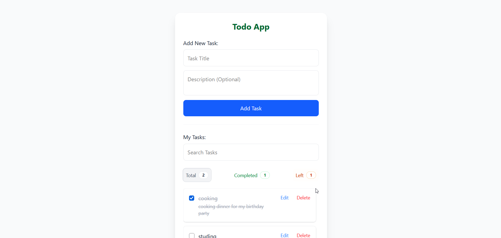

# Todo App (React & TypeScript)

# App Capture

# Tech Stack

Library: **React**
Language: **TypeScript**
Styling: **Tailwind CSS**
State Management: **Custom Hooks, Local Storage**
Build Tool: **Vite**

# Features

- **Add Todo**
- **Display Todos**
- **Delete Todos**
- **Done Todos**
- **Display Task State and Counts (Done | Left | All)**
- **Search Task**
- **Edit Task**

# Highlights | Code Decisions

- **Form Performance:** used `useState`/controlled components in form instead of action, to control input validation.
- **Separation of useLocalStorage:** I extracted the browser storage logic into `useLocalStorage` hook. This keeps the storage logic reusable.
- **Clean HTML:** Used implicit labeling (nesting `<input>` inside `<label>`). This removes the need for generating unique IDs.
- **Logic Focus**
  This task is not focused on style.
- **State Management Strategy:** choosed "Lifting State Up" over the Context API to avoid over-engineering, as the state is only passed down a single level to direct child components.
- **Browser Event Handling:** Used React's "SyntheticEvent" for cross-browser event handling."
- **Empty State:** Shows a clear message when there are no tasks, so the screen is never just blank.
- **Loading State:** Not needed. Because the app uses `localStorage`, the data loads instantly. Adding a loading spinner is not necessary.
- **Error Handling:** Form errors (like leaving the title empty) are checked and shown immediately to the user.

# Installation

1. Clone the repository:
2. cd ...
3. npm i
4. npm run dev
